<p align="center">
  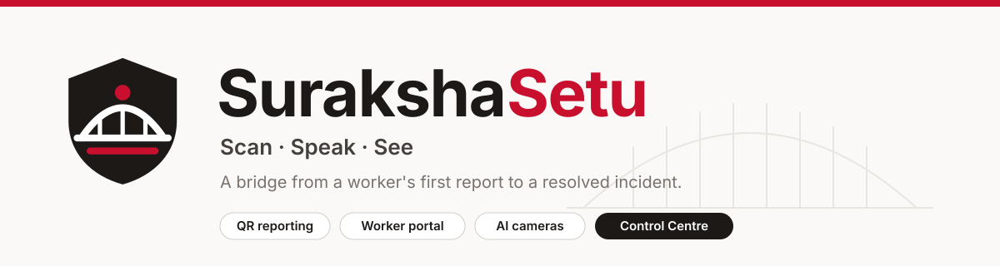
</p>

<p align="center">
  <b>SurakshaSetu</b> (सुरक्षा सेतु: <i>Suraksha</i> = safety, <i>Setu</i> = bridge)<br>
  One platform that carries an industrial hazard from a worker's first report, or a camera's first detection, to a resolved and closed incident.
</p>

<p align="center">
  
  
  
  
  
  
</p>

> **Honest by design.** This is a hackathon prototype on a **fictional plant ("Demo Plant — Line 3")**. It is not an official L'Oréal product, uses no L'Oréal logos, and contains no real L'Oréal incident data. Anything simulated is labelled _Simulated_ in the UI and in [docs/limitations.md](docs/limitations.md). Alerts are simulated until you switch them on. There is **no** police or ambulance integration.

---

## Contents

1. [The problem](#the-problem)
2. [What SurakshaSetu does](#what-surakshasetu-does)
3. [Screens](#screens)
4. [How it works (flowcharts)](#how-it-works)
5. [The nine AI capabilities, and how far to trust each](#the-nine-ai-capabilities)
6. [Quick start](#quick-start)
7. [Configuration](#configuration)
8. [Project structure](#project-structure)
9. [Testing](#testing)
10. [Privacy, safety and ethics](#privacy-safety-and-ethics)
11. [Limitations](#limitations)
12. [Documentation index](#documentation-index)
13. [Licences and credits](#licences-and-credits)

---

## The problem

Near misses and small hazards are the cheapest warnings a plant gets, and they are the most under-reported. Workers stay quiet because of fear of blame, the hassle of paperwork, and reports that seem to vanish. Cameras see events nobody reports, but their alerts rarely reach the right team quickly.

**SurakshaSetu closes all three gaps:** reporting takes under 30 seconds with no login, the reporter can see what happened next, and every camera detection lands in the same queue as human reports with an owner, a severity and a clock.

## What SurakshaSetu does

Three ways in, **one** backend, **one** incident database.

| #   | Product                     | Folder / port                   | Who uses it             | What it gives them                                                                                                                                         |
| --- | --------------------------- | ------------------------------- | ----------------------- | ---------------------------------------------------------------------------------------------------------------------------------------------------------- |
| 1   | **QR sticker reporting**    | `1-sticker-app` · `:5174`       | Any worker, any phone   | Scan a sticker on a machine; the machine, zone and department are already filled in. 3 steps, no login, offline queue.                                     |
| 2   | **Worker portal**           | `2-user-report-site` · `:5173`  | Workers, contractors    | Report from anywhere in 5 guided steps, **track** progress in plain language, **emergency guidance**, public "You said, we did" board. English and Hindi. |
| 3   | **Control Centre**          | `2-user-report-site` · `/admin` | EHS, security, managers | 12 sections: live CCTV, AI monitoring, incident case management, QR management, map, analytics, alert routing.                                              |
| 4   | **AI camera worker**        | `3-auto-cv`                     | Runs beside the cameras | Nine detector capabilities on cameras, video files or a webcam; confirmed, **pixelated** events are posted to the backend.                                 |
| –   | **Central backend**         | `backend` · `:8000`             | All of the above        | Triage, routing, roles, evidence, Telegram and voice alerts, escalation, analytics, live WebSocket updates, sticker rendering.                             |

**Highlights**

- **Explainable severity.** Every incident shows _why_ it is severity 1–5, as a list of rules. AI confidence is a separate number and never sets severity.
- **Human in the loop.** Camera detections are _potential_ events until a person verifies them; violence, fall and zero-shot detectors always require it.
- **Closes the loop.** The reporter sees an update; resolved fixes appear on a public board; analytics show response and resolution times.
- **Privacy built in.** Anonymous by default, people in camera evidence are pixelated, no face or emotion recognition, no per-person scoring.
- **Works on a bad network.** Reports queue on the phone and send themselves when the connection returns.

## Screens

<table>
  <tr>
    <td width="66%">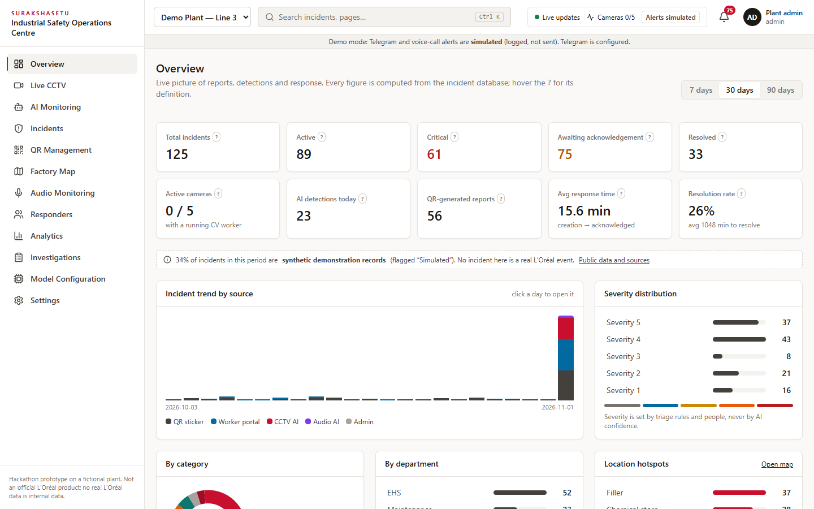</td>
    <td width="34%">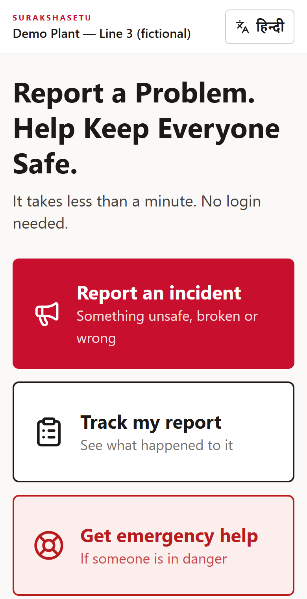</td>
  </tr>
  <tr>
    <td align="center"><b>Control Centre overview</b><br>Every KPI has a definition and opens a filtered list</td>
    <td align="center"><b>Worker portal</b><br>Report · Track · Emergency help</td>
  </tr>
  <tr>
    <td>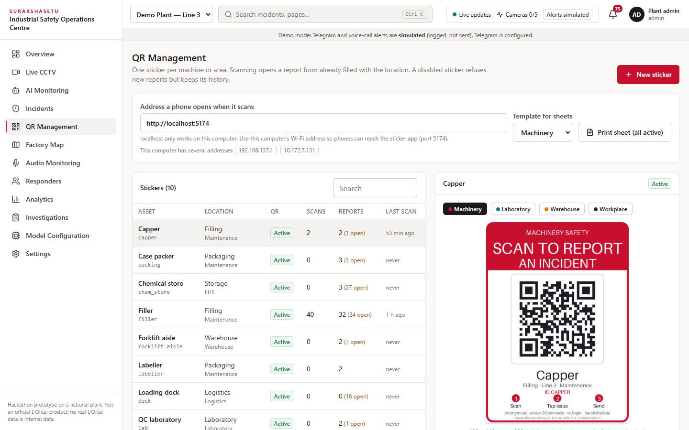</td>
    <td>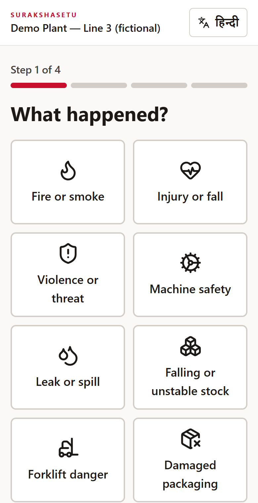</td>
  </tr>
  <tr>
    <td align="center"><b>QR Management</b><br>Four printable templates, PNG/PDF, scan history, disable/regenerate</td>
    <td align="center"><b>Guided report</b><br>Large tiles, one decision per screen</td>
  </tr>
  <tr>
    <td>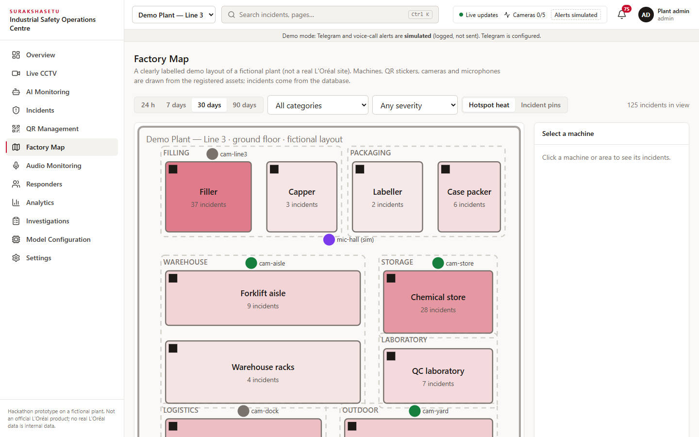</td>
    <td>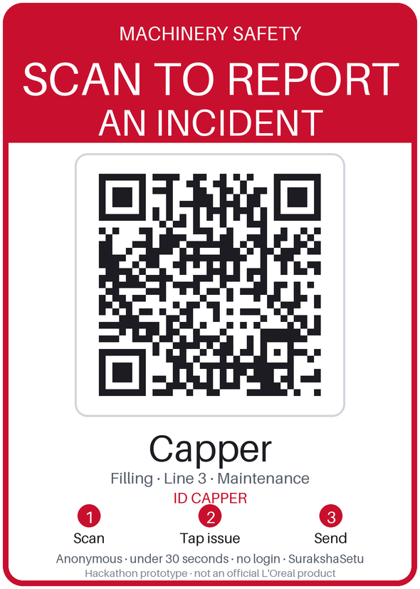</td>
  </tr>
  <tr>
    <td align="center"><b>Factory map</b> (clearly labelled demo layout)</td>
    <td align="center"><b>Print-ready sticker</b> (100 × 140 mm, 300 dpi)</td>
  </tr>
</table>

The **Live CCTV** workspace (dark theme) has a camera grid with 1 / 2 / 4 / 9 layouts, an expanded view with a bottom filmstrip, previous/next, full screen, a 24-hour event timeline with clip playback, and amber (potential) / red (confirmed) detection overlays. It is not pictured here because the demo footage is third-party sample video that is not redistributed; run `npm run demo:cameras` to see it.

## How it works

### 1. System architecture

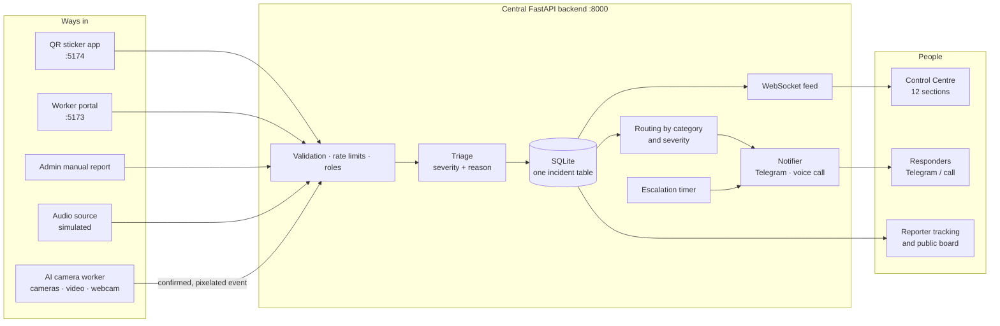

### 2. A worker's report: QR or portal

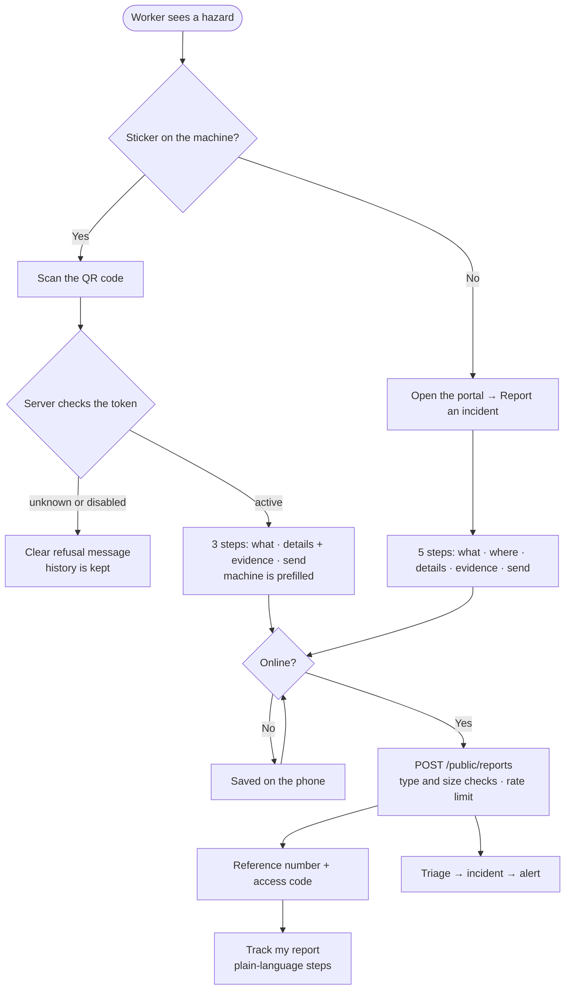

### 3. Incident lifecycle

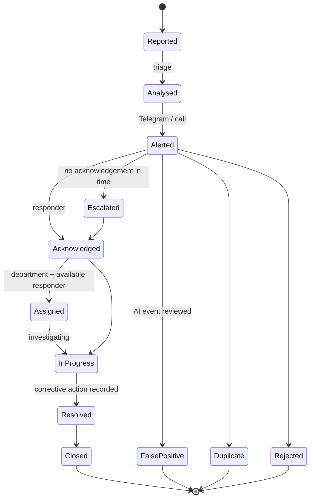

`Reported`, `Analysed`, `Alerted` and `Escalated` are the "needs acknowledgement" states. Invalid jumps (for example `Reported → Closed`) are refused by the API.

### 4. How severity is decided (and why it is not the AI's confidence)

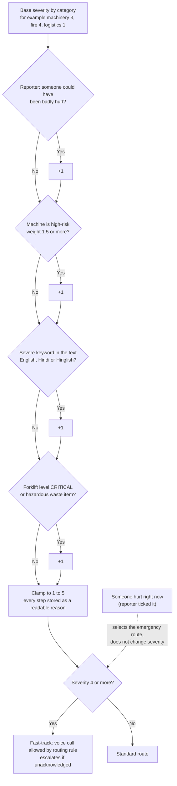

The weights are judgement calls, not calibrated to any plant (see [limitations](docs/limitations.md)). A manager can override severity and the override is logged. Model confidence is stored separately.

### 5. From camera frame to incident

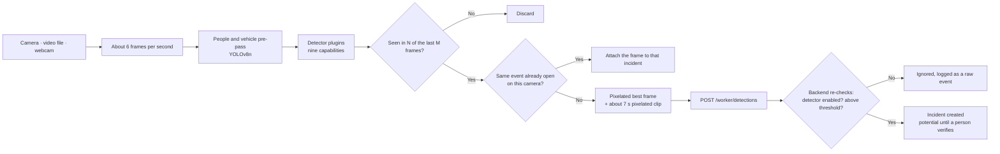

### 6. Alerts, acknowledgement and escalation

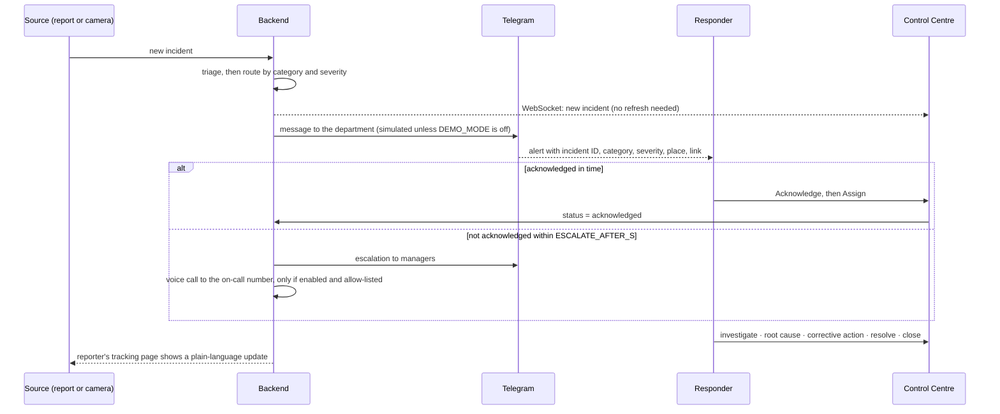

Voice calls are only ever placed to the configured on-call duty number or an explicit allow-list, and **never** to emergency-service numbers (100, 101, 102, 108, 112, 911…); this is enforced in code and tested.

## The nine AI capabilities

Each capability is a plugin of the same pipeline: same confirmation logic, same pixelated evidence, same incident path. **Maturity is shown honestly in the app** (Model Configuration page); no accuracy figure is claimed because none has been measured on a real plant.

| #   | Capability                      | Method and weights                                                                  | Status                                                                                                        |
| --- | ------------------------------- | ----------------------------------------------------------------------------------- | ------------------------------------------------------------------------------------------------------------- |
| 1   | Fire and smoke                  | Team's trained YOLOv8n weights (classes: Fire, Smoke)                               | **Trained, seen working** on a sample fire video; confidence there is moderate (0.4–0.7)                      |
| 2   | Person fall                     | Pose rules on YOLOv8n-pose (ported from the team's earlier repo)                    | Heuristic. No real fall footage was available, so **unverified**                                              |
| 3   | Possible violence               | Pose proximity/motion gate + CLIP (ported)                                          | Heuristic. **Missed** the one fight clip available. Always needs human verification                           |
| 4   | Person in a machine danger zone | Tracked people + a configured zone + the machine-running state                      | Rule. Verified on a people video. The running signal is simulated unless wired to a real one                  |
| 5   | Visible leak (gas or liquid)    | Third-party pipeline-leak YOLO11n (crack, gas, leak, no leak, water)                | Loads and runs. Trained on oil-and-gas pipelines; no positive sample to test. Cannot identify a chemical       |
| 6   | Falling or displaced boxes      | Third-party box detector + ByteTrack + motion rules                                 | Stop-gap (the requested repo had no weights). Rules unit-tested on synthetic tracks only                      |
| 7   | Forklift–pedestrian proximity   | Third-party forklift/person YOLO11n + ByteTrack; levels SAFE / CAUTION / CRITICAL   | **Verified on sample frames.** Distances are _estimates_ unless the camera is calibrated                      |
| 8   | Damaged packaging               | Third-party dent/dirt/hole detector + two-stage box → stain/puncture                | **Verified on sample photos.** Visible damage only; cannot check quantities or contents                       |
| 9   | Improper waste disposal         | Third-party 19-class waste detector + configured bin zones                          | Loads and runs; no positive sample. Classification alone never alerts: a bin or zone rule must be broken      |
| +   | PPE, hand in zone, blocked aisle | YOLO-World zero-shot and pose-wrist rules                                          | Experimental, zone-gated                                                                                      |
| +   | Audio (alarm, scream, glass)    | none connected                                                                      | **Simulated only**, always labelled                                                                           |

Full evaluation with the real class names printed from each model, sample results and rejected candidates: [docs/model-evaluation.md](docs/model-evaluation.md). Weight sources and licences: [3-auto-cv/models/third_party/SOURCES.md](3-auto-cv/models/third_party/SOURCES.md).

## Quick start

**Prerequisites:** Node.js 20+, Python 3.11+. No Java, no Firebase, no paid service.

```bash
git clone <this repository>
cd <folder>
npm install
pip install -r backend/requirements.txt
npm run dev          # API :8000 · worker portal :5173 · QR app :5174 (first start seeds machines and demo logins)
npm run seed         # optional: 40 clearly flagged synthetic past incidents for the analytics
```

| What                  | Where                                                                                           |
| --------------------- | ----------------------------------------------------------------------------------------------- |
| Worker portal         | <http://localhost:5173>                                                                         |
| QR app (stickers)     | <http://localhost:5174>                                                                         |
| Control Centre        | <http://localhost:5173/admin> · demo accounts `admin`, `manager.ehs`, `responder.maint` · password `demo1234` (local only) |
| Public board          | <http://localhost:5173/board>                                                                   |
| API documentation     | <http://localhost:8000/api/docs>                                                                |

**Try the QR flow on a phone.** Put the phone and the computer on the same Wi-Fi, open **Control Centre → QR Management**, set the address to your computer's Wi-Fi IP (it suggests one), then **Print sheet**. Phones cannot open `localhost`. Browsers only allow microphone access over HTTPS, so on plain `http://` the voice button may be refused; photo, video and typed details still work.

**Try the AI cameras.** The model weights and the demo videos are _not_ in this repository (licences, see below). To run the detectors, obtain the weights listed in [SOURCES.md](3-auto-cv/models/third_party/SOURCES.md), place your fire weights at `3-auto-cv/models/fire_smoke.pt`, then:

```bash
pip install -r 3-auto-cv/requirements.txt
cd 3-auto-cv
python -m vision_service.worker --source cam-store=path/to/video.mp4 --detectors fire --loop --realtime   # a video file
python -m vision_service.worker --source cam-line3=0                                                      # laptop webcam
python -m vision_service.worker                                                                           # every camera registered in the dashboard
```

Without any weights the whole platform (reporting, QR, tracking, workflow, analytics, simulated detections from the demo trigger) still works.

## Configuration

Copy `.env.example` to `.env` (never commit it). Everything is optional; with nothing set the app runs fully simulated.

| Variable                                          | Purpose                                                                                           |
| ------------------------------------------------- | ------------------------------------------------------------------------------------------------- |
| `DEMO_MODE` (default `true`)                      | `true` = Telegram and calls are **simulated** (logged, not sent). Set `false` to send for real.   |
| `TELEGRAM_BOT_TOKEN`, `TELEGRAM_CHAT_ID`          | Free Telegram bot (via @BotFather) and the chat that receives alerts                              |
| `CALLS_ENABLED`, `OMNIDIM_*`, `ALERT_PHONE_NUMBER` | Optional voice call to the on-call duty number. Never emergency numbers; allow-list enforced      |
| `ESCALATE_AFTER_S` (default 120)                  | Unacknowledged severity 4+ alerts escalate after this long                                        |
| `EVIDENCE_RETENTION_DAYS` (default 30)            | Evidence is deleted automatically after this                                                      |
| `JWT_SECRET`, `CV_WORKER_KEY`, `DEMO_PASSWORD`    | Change all three for any shared deployment                                                        |
| `QR_BASE_URL`, `PUBLIC_URL`                       | What a sticker opens, and the dashboard link used in alerts                                       |
| `SITE_EMERGENCY_CONTACT`, `ASSEMBLY_POINT`        | Shown on the worker "Emergency help" page (a call link appears only if you set a number)          |

Use **Control Centre → Settings → Send test Telegram** to check the bot before turning real alerts on.

## Project structure

```text
.
├── 1-sticker-app/            QR reporting app (React + Vite)           :5174
├── 2-user-report-site/       Worker portal + Control Centre (React)    :5173
│   └── src/{worker,routes,admin/{pages,components}}
├── 3-auto-cv/                AI camera worker (Python)
│   ├── vision_service/       worker, plugins, rules, privacy (pixelation), backend client
│   ├── models/               weights (not in git) + third_party/SOURCES.md
│   ├── zones/                per-camera zone files
│   └── tools/evaluate_models.py
├── backend/                  FastAPI app
│   └── app/{routers,services,domain.py,db.py,security.py,facts.py,detectors_catalog.py}
├── packages/common/          Shared React: design system (ui/), report wizard, offline queue, i18n
├── scripts/                  dev launcher, end-to-end tests, patches
├── docs/                     architecture, model evaluation, privacy, limitations, demo script, assets
└── legacy-firebase/          Archived first backend (not used)
```

## Testing

```bash
npm run lint && npm run typecheck      # ESLint, Prettier, strict TypeScript
npm test                               # web unit tests + 32 backend API tests
cd 3-auto-cv && python -m pytest       # 40 vision tests (rules, confirmation, pixelation, real-weight model tests)
npm run dev                            # in one terminal, then:
npm run e2e                            # Playwright + Chrome across all three portals
```

The browser test drives: a QR report, a worker-portal report and tracking (including lookup by reference + access code and a wrong code revealing nothing), the emergency page, the offline queue, Hindi, KPI click-through, a new incident appearing without refresh, the full response workflow, the public board, the CCTV workspace (search, expanded view, filmstrip, layouts), AI review, QR preview/PNG download/disable/enable, and every admin page.

## Privacy, safety and ethics

- **Anonymous by default.** No login to report. A name is optional and never required. Tracking uses a secret access code kept on the reporter's phone.
- **People are pixelated** in every saved camera image and clip, and in the live preview by default. Pixelation uses a low confidence threshold and expanded boxes, but a person the detector misses is not blurred (see limitations).
- **No face recognition, no emotion recognition, no per-person scoring or ranking.** Statistics are by zone and shift.
- **Evidence is access-controlled and expires.** Staff see it through short-lived signed links; files are deleted after the retention period; privileged actions are written to an audit log.
- **Cameras and microphones need consultation.** The Control Centre carries a notice that monitoring is for authorised use; ask workers and their representatives before deploying cameras.
- **Violence and other ambiguous events are never auto-confirmed.** They wait for a person.
- **The app does not call emergency services.** The worker help page says so and points to the plant's own procedure.

More in [docs/privacy-and-ethics.md](docs/privacy-and-ethics.md).

## Limitations

The full, honest list is [docs/limitations.md](docs/limitations.md). The ones that matter most:

- No model has been measured on this plant. Fall and violence are heuristics (violence missed the only clip tested). Several models are third-party and unverified on positive samples.
- Camera feeds in the demo are sample videos through the real pipeline, labelled "SAMPLE VIDEO · SIMULATED FEED". "LIVE" appears only for a real device. There is no continuous recording, only event clips.
- Alerts, the machine-running signal and audio events are simulated unless you wire real ones.
- Forklift distances are estimates unless a camera is calibrated.
- SQLite and a single process: fine for a demo or a small site, not for production scale.
- Not tested on real phones, screen readers, iOS Safari or real RTSP cameras.

## Documentation index

| Document                                                                          | What it covers                                                          |
| --------------------------------------------------------------------------------- | ----------------------------------------------------------------------- |
| [docs/architecture.md](docs/architecture.md)                                      | Backend, incident model, routing, alerts, security, CV pipeline         |
| [docs/model-evaluation.md](docs/model-evaluation.md)                              | Real class names, sample results and integration status per model       |
| [docs/design-research.md](docs/design-research.md)                                | UI audit, reference study, design system, information architecture      |
| [docs/limitations.md](docs/limitations.md)                                        | Everything simulated, assumed or unvalidated                            |
| [docs/privacy-and-ethics.md](docs/privacy-and-ethics.md)                          | Privacy by design and ethical use                                       |
| [docs/demo-script.md](docs/demo-script.md)                                        | A 7-minute demonstration, step by step                                  |
| [docs/risk-analysis.md](docs/risk-analysis.md), [implementation-plan.md](docs/implementation-plan.md), [metrics.md](docs/metrics.md), [eco-impact.md](docs/eco-impact.md) | Hackathon deliverables (parts written for the earlier Firebase version are marked) |
| [docs/roadmap-mesh.md](docs/roadmap-mesh.md)                                     | Vision only: low-network relay, deliberately not built                  |

## Licences and credits

- **This repository's code:** no open-source licence has been chosen yet; until one is added, all rights are reserved by the team.
- **Ultralytics YOLO / YOLO-World:** AGPL-3.0 (acceptable for a demo; production use needs an enterprise licence or a permissive detector).
- **OpenAI CLIP:** MIT. **Lucide icons:** ISC.
- **Third-party model weights** (forklift/person, leak, package damage, box detection, waste): credited with their licences in [SOURCES.md](3-auto-cv/models/third_party/SOURCES.md). Several repositories carry no licence file, so those weights were used locally with the owner's approval and are **not** committed. The waste model asks to be cited: _Siyad et al., 2026, Results in Engineering, doi:10.1016/j.rineng.2026.111286_.
- **UI references studied (no code copied):** [satnaing/shadcn-admin](https://github.com/satnaing/shadcn-admin), [react-scada-hmi](https://github.com/CoffeESIME/react-scada-hmi), [TailAdmin](https://github.com/TailAdmin/free-react-tailwind-admin-dashboard), plus the concepts of an IP-camera platform repo whose features could not be verified.
- **Public figures** shown in Settings come from L'Oréal's published documents with links and a note on how each was checked; the logo and banner in `docs/assets/` are original artwork.

<p align="center"><sub>SurakshaSetu · built for a hackathon, designed to be honest about what it is.</sub></p>
# SurakshaSetu

